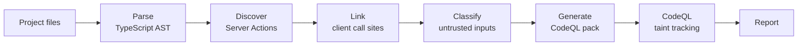

# Architecture

ActionTaint is a **semantic adapter** between Next.js and a general-purpose taint engine. It does not implement its own data-flow solver. It recovers the framework facts that a JavaScript analyzer cannot see (which functions are client-callable endpoints, and which of their inputs the client controls), turns them into a CodeQL query, and lets CodeQL solve the flows.

## Pipeline and module map

| # | Stage | Module | Input → Output |
|---|---|---|---|
| 0 | CLI | `cli.py` | command line → one of `scan`, `eval`, `convert-semgrep`, `compare` |
| 0 | Orchestration | `pipeline.py` | runs stages 1–7 → `AnalysisResult` |
| 1 | Scan | `scanner.py` | project dir → `ProjectInfo` (Next.js version, routers, sorted source files) |
| 2 | Parse | `ast_parser.py` + `parsers/ts_ast_extractor.cjs` | files → JSON facts per file (functions, imports, directives, JSX call sites, hooks, `.bind`, hidden inputs, calls) |
| 3 | Discover | `discovery.py` | facts → `FunctionDef`s with `server_action` set; imports resolved to files (relative paths, `@/`, `tsconfig` `paths`) |
| 4 | Link | `callsite.py` | actions + facts → `ReachableAction`s, each with the call sites that make it client-reachable |
| 5 | Classify | `boundary.py` + `source_classifier.py` | reachable actions → `BoundaryModel`s with `SourceSpec`s (which parameters or values are untrusted, and why) |
| 6 | Generate | `taint_model.py` | boundary models → CodeQL pack (`qlpack.yml`, query, JSON model) |
| 7 | Solve | `backends/codeql.py` | pack → `Finding`s (create DB, `pack install`, analyze, parse SARIF) |
| 8 | Report | `reporter.py` | `AnalysisResult` → CLI / JSON / SARIF / CSV / HTML |
| – | Evaluation | `evaluation.py`, `comparison.py` | benchmark scoring and cross-tool comparison (outside the analysis pipeline) |
| – | Shared | `models.py`, `utils.py` | data classes and text helpers |

### Parsing (stage 2)

Python starts Node once per scan and sends the file list on stdin. The extractor uses the TypeScript compiler API, which parses without type-checking, so it is fast and tolerates projects that do not compile. It returns normalized JSON facts. If Node or TypeScript is missing, `discovery.py` falls back to a regex parser and records a warning. The parser actually used is reported.

### Server Action rule (stage 3)

A function is a Server Action when it is **async** and either

- its body starts with `"use server"` (inline), or
- its file starts with `"use server"` and it is exported: `export async function`, `export const f = async () => {}`, `export default async function`, `export { f }`, or `export { f as g }`.

This follows the Next.js [`use server` documentation](https://nextjs.org/docs/app/api-reference/directives/use-server).

### Reachability (stage 4)

An action enters the analysis only if one of these call sites references it (directly, through an import alias, `NS.action` for a namespace import, a `.bind` alias, or a `useActionState` alias):

| Call site | Recorded reason |
|---|---|
| `<form action={a}>` | `used in <form action={a}>` |
| `<button formAction={a}>`, `<input formAction={a}>` | `used in <button formAction={a}>` |
| `useActionState(a, …)`, `useFormState(a, …)` | `used in useActionState(a, ...)` |
| `<Component somethingAction={a}>` | `passed to client-reachable component ...` |
| `a(...)` in a `"use client"` file | `imported Server Action called from 'use client' file` |

Actions that no client code references are not analyzed. This is a deliberate scoping choice to keep noise low. Next.js 15 drops unused actions from the client bundle, but an exported action can still be invoked directly in some setups, so such actions are a known source of false negatives.

### Source classification (stage 5)

| Source kind | Rule |
|---|---|
| `form_data_parameter` | parameter typed `FormData` or named `formData`, `form`, `fd` |
| `inferred_form_data_parameter` | action is used as a form action but has no obvious FormData parameter; the parameter after any bound arguments and `useActionState`'s previous-state argument is used |
| `client_argument` | parameters of an action called directly from a `"use client"` file |
| `bind_search_param`, `bind_route_param`, `bind_form_data_derived`, `bind_request_metadata`, `bind_possibly_tainted` | non-literal `.bind(null, …)` argument, classified by its expression |
| `closure_search_param`, `closure_route_param` | an inline action that uses `searchParams` / `params` captured from the enclosing page |

Literal bind arguments and values that look server-side (`session`, `auth`, `currentUser`) are trusted.

## Generated CodeQL query (stage 6)

The query in `<model-dir>/codeql-pack/queries/ActionTaintGenerated.ql` has three parts.

**Generated part:** one clause per source spec, keyed by file, function name, and parameter index (or captured variable name). Nothing else in the query is project-specific.

**Sources:**
- the parameter itself
- `param.get()` / `param.getAll()` calls
- `Object.fromEntries(param)`
- reads of captured `searchParams` / `params` variables

**Sinks:** matched by method or callee *name*, never by `Expr.toString()`, because CodeQL abbreviates long expressions such as `prisma.$queryRawUnsafe` in `toString()`.

| Class | Matching rule |
|---|---|
| SQL | method `query`, `execute`, `$queryRawUnsafe`, `$executeRawUnsafe`, or `sql.raw`; argument 0. If the argument is an object literal (`{ text, values }`), only its `text`/`sql`/`query` property is a sink. |
| SSRF | `fetch`, `axios`, `got` calls, `axios.*` / `got.*` methods; argument 0, unless it starts with a constant `https://host/` prefix |
| Open redirect | `redirect`, `permanentRedirect`, `NextResponse.redirect`; argument 0, unless it starts with a constant same-origin path such as `/posts/` |
| Path traversal | `readFile`, `writeFile`, `unlink`, `createReadStream` (and sync variants); argument 0 |
| Command | CodeQL's `SystemCommandExecution` model (for example `child_process`) plus `execa`; command and argument list |
| IDOR | `x.<model>.update/updateMany/delete/deleteMany/upsert(arg)` with no ownership field reachable in `arg`; Supabase `from(t).delete()/update()/upsert()` followed by `.eq/.in/.match` with no ownership filter |

**Barriers and steps:**
- A call whose name contains `assertAllowed`, `assertAllowlisted`, `allowlist`, `isAllowedHost`, `assertInternalUrl`, `assertRelativePath`, or `trustedServerValue` stops taint.
- One extra flow step (property value → enclosing object literal) lets a tainted `id` taint `{ where: { id } }`, which the IDOR sink needs.

**Ownership fields:** matched case-insensitively, camelCase or snake_case: `userId`, `ownerId`, `authorId`, `createdBy`, `teamId`, `orgId`, `organizationId`, `tenantId`, `workspaceId`, `accountId`.

The pack pins `codeql/javascript-all` 2.7.0. The backend runs `codeql pack install` before every analysis, which downloads the library once and reuses the local cache afterwards.

## Findings (stage 7)

Each SARIF result becomes a `Finding` with:

- vulnerability type
- source (`file::function` and parameter)
- sink file, line, and the source line of code
- the full taint path
- a severity: command injection CRITICAL; SQL, SSRF, path traversal, IDOR HIGH; open redirect MEDIUM

The CodeQL database is recreated on every scan, so findings always describe the current code. Any CodeQL failure is returned as an error, and the CLI exits with code `2`, instead of reporting "no findings".

## Design decisions

- **Framework semantics vs. flow solving:** the two stay separate. The contribution is the boundary model; CodeQL provides interprocedural taint tracking.
- **Conservative sanitizers:** type validation (for example zod) is not a barrier. Only explicit allowlist or assertion calls are.
- **Reachability-gated sources:** parameters of actions that no client code references are not sources. This keeps noise low on large applications, at the cost of possibly missing directly-invoked actions.
- **Deterministic output:** files and functions are sorted, so repeated runs produce identical reports.
